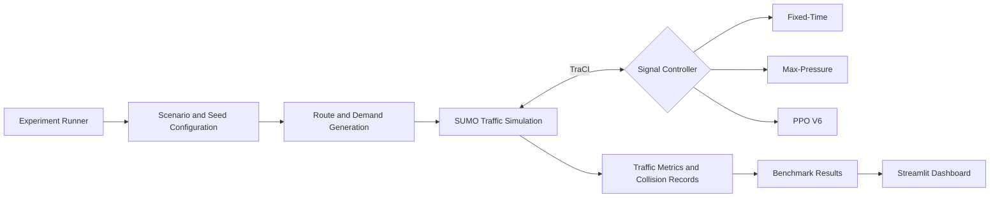

# 🚦 SignalSim
### Adaptive Traffic Signal Control Under Heterogeneous Left-Hand Traffic Dynamics

## Team

**Team Name:** drititotla

| Contributor | GitHub Profile |
|---|---|
| Driti Totla | [@drititotla-ui](https://github.com/drititotla-ui) |
| Pritika Jain | [@mailtopritika-ux](https://github.com/mailtopritika-ux) |


A SUMO-based traffic simulation and benchmarking platform comparing Fixed-Time, Max-Pressure, and Proximal Policy Optimisation (PPO V6) traffic signal controllers under heterogeneous left-hand traffic conditions.


**Repository:** [drititotla/Signal-Sim](https://github.com/drititotla-ui/Signal-Sim)

---

## Overview

### The Problem

Indian urban intersections operate under heterogeneous traffic conditions, with a mixture of cars, motorcycles, auto-rickshaws, buses, trucks, and bicycles. These vehicles differ in size, movement patterns, and traffic behaviour.

Conventional fixed-time traffic signals follow predetermined phase durations regardless of current traffic conditions. Adaptive controllers attempt to respond to changing demand, but their effectiveness must be evaluated against reliable baselines.

SignalSim investigates two questions:

- How do conventional and reinforcement-learning-based traffic signal controllers compare under heterogeneous left-hand traffic conditions?
- How does increasing signal clearance time affect the trade-off between traffic efficiency and simulated collision events?

### Our Approach

SignalSim provides a reproducible SUMO simulation and benchmarking pipeline for evaluating three traffic signal controllers at the J2 intersection.

It compares controller performance under identical demand scenarios and random seeds, followed by a separate safety-adjusted evaluation using a longer all-red clearance interval.

**Scope:** This is a simulation study of a single intersection. The results do not establish real-world deployment readiness, real-world crash reduction, or regulatory compliance.

---

## Key Features

- Heterogeneous left-hand traffic simulation using SUMO.
- Deterministic route and traffic demand generation.
- Automated experiment execution across multiple scenarios and seeds.
- Comparison of Fixed-Time, Max-Pressure, and PPO V6 controllers.
- PPO-based reinforcement learning using Stable-Baselines3 and PyTorch.
- Traffic performance evaluation using travel time, waiting time, time loss, and throughput.
- Collision analysis using SUMO simulation summary records.
- Original versus safety-adjusted benchmark comparison.
- Interactive Streamlit dashboard for exploring results.

---

## Dashboard

SignalSim includes an interactive Streamlit dashboard for exploring benchmark results, comparing controllers, and examining the safety evaluation.

### Dashboard previews

Place actual screenshots in `assets/screenshots/` and use these paths:

| Dashboard view | Screenshot |
|---|---|
| Dashboard overview | `assets/screenshots/dashboard-overview.png` |
| Controller comparison | `assets/screenshots/controller-comparison.png` |
| Safety evaluation | `assets/screenshots/safety-evaluation.png` |
| Simulation interface | `assets/screenshots/simulation.png` |

**Live dashboard:** To be added after deployment.

---

## System Architecture



### Workflow

1. The experiment runner loads the selected scenario, controller, and random seed.
2. The route generator creates deterministic traffic demand.
3. SUMO executes the intersection simulation.
4. The selected controller interacts with SUMO through TraCI.
5. Traffic performance metrics and collision records are collected.
6. Results are stored and made available to the Streamlit dashboard.

---

## Traffic Signal Controllers

| Controller | Category | Description |
|---|---|---|
| **Fixed-Time** | Conventional baseline | Uses a predefined signal phase sequence with fixed green, yellow, and all-red durations. |
| **Max-Pressure** | Adaptive, rule-based | Selects signal phases using upstream and downstream traffic pressure. |
| **PPO V6** | Reinforcement learning | Uses a PPO policy trained with Stable-Baselines3 to select signal phases based on observed traffic conditions. |

### PPO V6

PPO V6 uses a neural-network policy with an 18-dimensional observation space and two possible phase-selection actions.

The controller is implemented using Stable-Baselines3 and PyTorch. Its implementation includes minimum-green and maximum-green constraints, along with signal transition handling.

PPO V6 is evaluated as an experimental controller against conventional baselines. Its inclusion does not imply superior performance.

---

## Simulation Methodology

### Simulation Configuration

| Parameter | Configuration |
|---|---|
| Simulator | Eclipse SUMO |
| Simulation interface | TraCI |
| Traffic system | Left-hand traffic |
| Intersection | J2 |
| Simulation step length | 0.1 seconds |
| Controller decision interval | 10 seconds |
| Warm-up period | 600 seconds |
| Evaluation period | 3,600 seconds |
| Drain period | 900 seconds |
| Total simulation duration | 5,100 seconds |
| Random seeds | 42, 101, 202, 303, 404 |

### Demand Scenarios

Four demand levels were evaluated:

| Scenario | Demand multiplier |
|---|---:|
| S1 | 0.50× |
| S2 | 0.75× |
| S3 | 1.00× |
| S4 | 1.25× |

Each scenario was evaluated using five deterministic seeds and all three controllers.

**Per benchmark configuration:**

- 4 demand scenarios
- 5 random seeds
- 3 controllers
- 20 runs per controller
- **60 simulation runs**

Two configurations were evaluated: the original and the safety-adjusted benchmark, giving **120 simulation runs in total**.

### Vehicle Composition

The configured fleet contains six vehicle categories:

| Vehicle category | Count |
|---|---:|
| Car | 1,200 |
| Bike | 900 |
| Auto-rickshaw | 720 |
| Bus | 240 |
| Truck | 300 |
| Bicycle | 600 |
| **Total** | **3,960** |

The route generator uses a 20% left-turn, 60% straight, and 20% right-turn distribution.

### Evaluation Metrics

- **Mean travel time:** Average travel time of completed vehicles.
- **Mean waiting time:** Average time vehicles spend waiting.
- **Mean time loss:** Time lost compared with ideal travel conditions.
- **Throughput:** Completed evaluation vehicles per hour.
- **Collisions:** Events recorded by SUMO's collision model.

The evaluation uses the same scenario and seed combinations across controllers to support matched comparisons.

---

## Benchmark Results

The original benchmark compares all three controllers across four demand scenarios and five random seeds.

### Original Benchmark — Controller Performance

The following values represent averages across 20 runs per controller.

| Controller | Travel time (s) | Waiting time (s) | Time loss (s) | Throughput (veh/h) |
|---|---:|---:|---:|---:|
| Fixed-Time | 21.17 | 9.31 | 14.38 | 2,108.82 |
| Max-Pressure | **17.69** | **6.12** | **10.90** | 2,108.80 |
| PPO V6 | 22.26 | 10.42 | 15.44 | 2,108.33 |

### Key Findings

- **Max-Pressure achieved the best average travel time, waiting time, and time loss.**
- Fixed-Time provided a conventional baseline for comparison.
- PPO V6 did not outperform the conventional controllers on the principal efficiency metrics.
- Throughput remained nearly identical across all three controllers.

These findings demonstrate the importance of evaluating reinforcement-learning approaches against established conventional baselines rather than assuming a learned controller will perform better.

---

## Safety Evaluation

A second benchmark configuration investigated the effect of increasing the all-red signal clearance interval from **1 second to 3 seconds**. The yellow interval remained at 3 seconds.

### Collision Comparison

| Controller | Original collisions | Safety-adjusted collisions | Reduction |
|---|---:|---:|---:|
| Fixed-Time | 93 | 53 | 43.0% |
| Max-Pressure | 133 | 119 | 10.5% |
| PPO V6 | 172 | 101 | 41.3% |
| **Total** | **398** | **273** | **31.4%** |

Across the two benchmark configurations, SUMO recorded 125 fewer collision events in the safety-adjusted configuration.

### Efficiency Trade-off

The increased clearance interval was also associated with higher average waiting times.

| Controller | Original waiting time (s) | Safety-adjusted waiting time (s) |
|---|---:|---:|
| Fixed-Time | 9.31 | 10.54 |
| Max-Pressure | 6.12 | 7.45 |
| PPO V6 | 10.42 | 11.52 |

### Interpretation

The safety-adjusted configuration recorded fewer simulated collision events, but this improvement came with increased waiting times.

This highlights the trade-off between clearance timing and traffic efficiency within the simulated environment.

**Important limitations:**

- Collision counts are generated by SUMO's simulation model.
- These results do not demonstrate real-world crash reduction.
- The results do not establish regulatory compliance or real-world deployment readiness.
- The comparison evaluates two configurations and should not be interpreted as proof that the same effect will occur at physical intersections.

---

## Technology Stack

| Component | Technology |
|---|---|
| Programming language | Python |
| Traffic simulation | Eclipse SUMO |
| Simulation interface | TraCI |
| Reinforcement learning | Stable-Baselines3 |
| Deep learning | PyTorch |
| Dashboard | Streamlit |
| Data processing | Pandas, NumPy |
| Visualisation | Altair |
| Testing | Pytest |

---

## Repository Structure

```text
Signal-Sim/
├── configs/
│   ├── experiment.yaml
│   └── experiment_safety.yaml
├── dashboard/
│   ├── app.py
│   └── views/
├── experiments/
│   └── run_experiments.py
├── lht_working/
│   └── candidate/
├── models/
│   └── ppo_v6_model.zip
├── results/
│   ├── summaries/
│   └── safety/
│       └── summaries/
├── simulation/
├── src/
│   ├── dashboard/
│   └── experiments/
├── sumo_simulation/
│   └── controllers/
├── tests/
├── pytest.ini
├── requirements.txt
└── README.md
```

The repository also includes supporting SUMO network, route-generation, and experiment configuration files.

---

## Installation

### Prerequisites

- Windows
- Python
- Eclipse SUMO
- Git

SUMO should be installed and accessible through the system PATH. Configure `SUMO_HOME` where required by the installation.

### 1. Clone the repository

```powershell
git clone https://github.com/drititotla-ui/Signal-Sim.git
cd Signal-Sim
```

### 2. Create a virtual environment

```powershell
python -m venv .venv
```

### 3. Activate the environment

```powershell
.\.venv\Scripts\Activate.ps1
```

### 4. Install dependencies

```powershell
pip install -r requirements.txt
```

### 5. Verify SUMO

```powershell
sumo --version
```

---

## Running the Project

### Launch the dashboard

```powershell
python -m streamlit run dashboard\app.py
```

### Run the original benchmark

```powershell
python experiments\run_experiments.py --controllers fixed_time max_pressure ppo_v6 --scenarios S1 S2 S3 S4 --seeds 42 101 202 303 404
```

### Run the safety-adjusted benchmark

```powershell
python experiments\run_experiments.py --config configs\experiment_safety.yaml --controllers fixed_time max_pressure ppo_v6 --scenarios S1 S2 S3 S4 --seeds 42 101 202 303 404
```

**Note:** Each complete benchmark configuration runs 60 SUMO simulations and may take considerable time. Existing benchmark outputs are included in the repository.

---

## Testing

Run the test suite using:

```powershell
python -m pytest
```

The test suite covers experiment execution, controller integration, PPO V6 behaviour, signal transition safety, dashboard data processing, and benchmark comparison.

At the safety-benchmark integration checkpoint, **97 tests passed**.

---

## Limitations and Future Work

### Current Limitations

- The evaluation is limited to one simulated intersection.
- Traffic demand and vehicle behaviour are simulated rather than calibrated against field measurements.
- PPO V6 did not outperform Max-Pressure in the evaluated experiments.
- Increased all-red clearance reduced recorded collisions but increased waiting time.
- SUMO collision counts are simulation outputs, not estimates of real-world crash rates.

### Possible Future Improvements

- Calibration and validation against observed Indian traffic data.
- Extension to multiple coordinated intersections.
- Further refinement of PPO observations, reward functions, and training.
- Joint optimisation of traffic efficiency and safety.
- Evaluation under additional traffic demand patterns and vehicle compositions.

---

## Team

**Team Name: drititotla**

- **Driti**
- **Pritika**

## Acknowledgements

- [Eclipse SUMO](https://eclipse.dev/sumo/) and TraCI
- [Stable-Baselines3](https://github.com/DLR-RM/stable-baselines3)
- [PyTorch](https://pytorch.org/)
- [Streamlit](https://streamlit.io/)

---

## License

No license has been specified yet. A license should be added before distributing the project as open-source software.