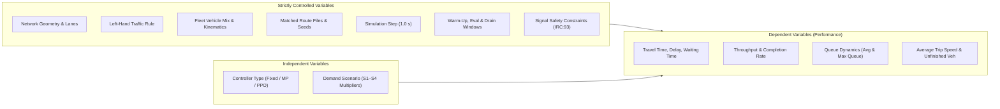

# Controlled Variable Register and Experimental Controls

This document establishes the controlled-variable protocol for **SIGNALSIM-INDIA**. It delineates the independent, dependent, and controlled variables, explaining the physical and methodological justification for holding each controlled variable constant across all controller evaluations.

---

## 1. Overview of Experimental Variables

In scientific benchmarking of traffic controllers, the observed differences in performance metrics must be strictly causally attributable to the control logic of the competing algorithms (Fixed-Time, Max-Pressure, PPO), rather than exogenous variations in demand, driver behavior, or simulation artifacts.

---

## 2. Independent Variables

The independent variables are deliberately manipulated across experimental trials:

1. **Controller Type ($C_m$)**:
   - `fixed_time`: Fixed-time signal controller operating with static cycle time and predetermined stage splits designed per IRC:93-1985 guidelines.
   - `max_pressure`: Decentralized max-pressure controller dynamically prioritizing phases with maximal queue-differential pressure between inbound and outbound links.
   - `ppo`: Proximal Policy Optimization reinforcement learning controller executing deterministic inference with frozen policy weights.
2. **Traffic Demand Scenario ($S_k$)**:
   - `S1` (0.50x demand multiplier): Unsaturated, off-peak regime.
   - `S2` (0.75x demand multiplier): Moderate, medium flow regime.
   - `S3` (1.00x demand multiplier): Nominal baseline design capacity regime.
   - `S4` (1.25x demand multiplier): Oversaturated, peak congestion regime.

---

## 3. Dependent Variables (Evaluation Metrics)

The system response is quantified via nine dependent variables:
1. Average Travel Time ($\bar{T}$, $\text{s}$)
2. Average Waiting Time ($\bar{W}$, $\text{s}$)
3. Average Time Loss ($\bar{L}$, $\text{s}$)
4. Throughput ($Q$, $\text{veh/h}$)
5. Completion Rate ($C_R$, $\%$)
6. Average Queue Length ($\bar{Q}_L$, $\text{m}$ or $\text{veh}$)
7. Maximum Queue Length ($Q_{L,max}$, $\text{m}$ or $\text{veh}$)
8. Average Trip Speed ($\bar{V}$, $\text{km/h}$)
9. Unfinished Vehicles ($N_{\text{unf}}$, count)

---

## 4. Controlled Variables Register

Each controlled variable listed below **must remain 100% identical** across all controller evaluations within a given scenario and seed:

### 4.1 Network Geometry
- **Description**: Physical alignment, length of intersection approach arms (North, South, East, West), intersection curb radii, and junction node coordinates.
- **Why It Matters**: Arm length dictates storage capacity for queuing vehicles. Curb radii dictate turning speed envelopes. Changing geometry between runs would alter spatial queue capacities and travel distances.
- **Enforcement**: Stored in a single, version-controlled SUMO network file (`.net.xml`) supplied by P1 and loaded read-only by all controllers.

### 4.2 Lane Configuration
- **Description**: Number of approach and departure lanes per arm, dedicated turning bays, lane widths, and connection maps.
- **Why It Matters**: Lane allocation governs physical saturation flow rates and lane-changing opportunities.
- **Enforcement**: Hardcoded into the common SUMO network file; no dynamic lane modifications or lane closures allowed.

### 4.3 Traffic Direction
- **Description**: Left-hand traffic (LHT) convention mandated by the Indian Motor Vehicles Act.
- **Why It Matters**: In LHT, left-turning movements are near-side turns with minimal conflict, while right-turning movements cross opposing through-traffic. Inverting or mixing rules would invalidate phase conflicts.
- **Enforcement**: Parameterized globally in SUMO network generation and trajectory rules.

### 4.4 Vehicle Composition (Fleet Mix)
- **Description**: Relative proportion of vehicle classes (two-wheelers, three-wheelers/autos, passenger cars, light commercial vehicles, buses, trucks).
- **Why It Matters**: Indian mixed traffic exhibits extreme heterogeneity. Two-wheelers have small footprints, high acceleration, and seep through queues; buses occupy large space with slow clearance. Discrepancies in fleet mix would skew travel times and queue formation.
- **Enforcement**: Fixed in the scenario configuration files (`configs/scenarios/S*.yaml`) and sampled identically by the deterministic route generator.

### 4.5 Turning Proportions
- **Description**: Fraction of vehicles executing left-turns, through-movements, and right-turns from each approach arm.
- **Why It Matters**: Turning movements directly govern phase loading and phase conflict severity. An unintended shift toward right-turning traffic artificially penalizes controllers with simple phase structures.
- **Enforcement**: Fixed turning probability matrices specified in scenario configurations and embedded into the pre-generated route files.

### 4.6 Vehicle Characteristics (Kinematics)
- **Description**: Physical dimensions (length, width), minimum headway distance (`minGap`), maximum acceleration, comfortable deceleration, emergency deceleration, and car-following model parameters.
- **Why It Matters**: Governs acceleration from standstill, queue discharge rates, and lateral spacing in mixed traffic.
- **Enforcement**: Centralized in P1's vehicle types definition file (`.vtype.xml`) referenced by all simulation runs.

### 4.7 Route Files and Departure Schedule
- **Description**: The exact timestamp, origin arm, destination arm, vehicle type, and vehicle ID assigned to every trip.
- **Why It Matters**: Using on-the-fly random insertion creates subtle timing discrepancies between controller runs. A matched route file ensures every controller confronts the exact same vehicle arrival sequence down to the millisecond.
- **Enforcement**: Generated upfront by P2's deterministic route generator and persisted to disk as `simulation/routes/route_S{k}_seed{i}.rou.xml`.

### 4.8 Random Seed
- **Description**: Master pseudo-random number generator seed controlling SUMO internal stochasticity (e.g., driver car-following noise $\sigma$).
- **Why It Matters**: SUMO stochastic driver behaviors must be perfectly synchronized across controller runs.
- **Enforcement**: Seed value passed via SUMO command line `--seed <seed_value>` matching the seed used to generate the route file.

### 4.9 Simulation Step Length
- **Description**: Discrete integration time-step ($\Delta t$) of the TraCI simulation engine.
- **Why It Matters**: $\Delta t$ determines the granularity of collision detection, queue measurement, and controller decision frequency. Coarser steps distort acceleration and queue discharge dynamics.
- **Enforcement**: Set strictly to $\Delta t = 1.0\text{ s}$ across all experiments in `configs/experiment.yaml`.

### 4.10 Warm-Up Duration ($T_{\text{warm}}$)
- **Description**: Initial simulation window during which the network is filled with traffic to achieve stochastic equilibrium.
- **Why It Matters**: Starting from an empty network artificially depresses travel time and delays. All controllers must undergo the exact same warm-up duration before metric collection starts.
- **Enforcement**: Fixed globally in `configs/experiment.yaml` (provisional default: $600\text{ s}$); all departures occurring at $t < T_{\text{warm}}$ are excluded from evaluation metrics.

### 4.11 Evaluation Duration ($T_{\text{eval}}$)
- **Description**: Duration of the active measurement window during which evaluation cohort vehicles enter the network.
- **Why It Matters**: Throughput and completion metrics depend directly on evaluation window length.
- **Enforcement**: Fixed globally in `configs/experiment.yaml` (provisional default: $3600\text{ s}$).

### 4.12 Drain Duration ($T_{\text{drain}}$)
- **Description**: Simulation clearance period following the close of the evaluation window, allowing in-flight cohort vehicles to complete their trips.
- **Why It Matters**: Truncating the simulation immediately at the end of the evaluation window introduces severe survivorship bias by abandoning vehicles queued inside the intersection.
- **Enforcement**: Fixed globally in `configs/experiment.yaml` (provisional default: $900\text{ s}$).

### 4.13 Signal Safety Constraints
- **Description**: Universal safety boundaries enforced during phase transitions: minimum green time ($G_{\text{min}}$), maximum green time ($G_{\text{max}}$), yellow change interval ($Y$), and all-red clearance interval ($AR$).
- **Why It Matters**: An unconstrained controller could switch phases instantaneously with zero yellow/all-red time, achieving deceptively higher capacity while violating safety standards (IRC:93-1985).
- **Enforcement**: Mediated uniformly by P1's Traffic Signal Safety Manager wrapper. Any phase transition proposed by an adaptive or RL controller must strictly pass through this safety filter.

### 4.14 Metric Definitions and Parser Logic
- **Description**: Mathematical equations, filtering conditions, and unit conversions applied to raw simulation outputs.
- **Why It Matters**: Inconsistent metric definitions (e.g. including warm-up vehicles for one controller but excluding them for another) invalidate benchmarking.
- **Enforcement**: Handled exclusively by P2's automated parser pipeline (`src/metrics/tripinfo_parser.py`) applying identical rules across all controller logs.

---

## 5. Permitted Controller-Specific Variations

To prevent misunderstanding, the following behaviors are **permitted and expected** to differ between controllers, as they represent the intrinsic decision-making capability of each algorithm:
- Real-time phase selection (which movement receives green).
- Green duration per cycle (between $G_{\text{min}}$ and $G_{\text{max}}$).
- Cycle length (fixed vs adaptive cycle or cycle-free actuation).
- Phase sequence (cyclic vs acyclic phase skips).

All inputs, safety guardrails, and evaluative lenses remain strictly identical.

