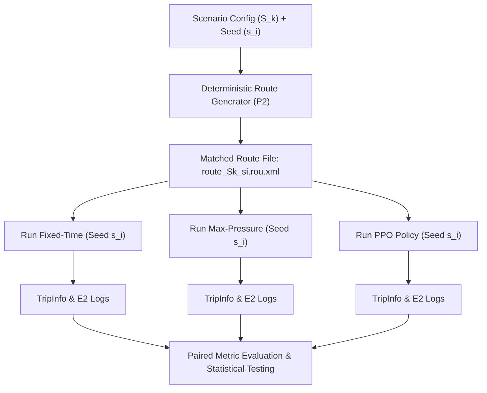

# Experimental Methodology

## 1. Research Objective

The primary objective of **SIGNALSIM-INDIA** is to conduct a rigorous, statistically robust, and reproducible comparative evaluation of three distinct traffic signal control paradigms operating on a standard four-arm Indian mixed-traffic urban intersection:

1. **Fixed-Time Signal Control**: Baseline plan calibrated using empirical Indian Road Congress guidelines (IRC:93-1985) with fixed cycle times and pre-determined phase splits.
2. **Max-Pressure Signal Control**: Dynamic, decentralized heuristic algorithm that minimizes network-wide pressure by balancing queue length differentials between incoming and outgoing approaches.
3. **PPO Reinforcement Learning Signal Control**: Deep reinforcement learning agent trained via Proximal Policy Optimization (PPO) using TraCI/Gymnasium, adapting phase choices to maximize cumulative throughput and minimize delay.

Indian road networks are characterized by left-hand traffic (LHT), high heterogeneity in vehicle kinematics (two-wheelers, three-wheelers, passenger cars, auto-rickshaws, and heavy vehicles), non-lane-based movement, and pronounced peak/off-peak saturation shifts. This methodology defines the experimental protocol ensuring unbiased, fair, and reproducible benchmarking across all three controllers.

---

## 2. Experimental Variables

### 2.1 Independent Variables
The independent variables deliberately manipulated to observe system response are:
- **Controller Type**:
  - `fixed_time` (IRC baseline)
  - `max_pressure` (Dynamic queue-differential heuristic)
  - `ppo` (Trained deep reinforcement learning policy with frozen evaluation weights)
- **Traffic Demand Scenario**:
  - `S1` (0.50x baseline demand — Unsaturated / Off-peak)
  - `S2` (0.75x baseline demand — Moderate flow)
  - `S3` (1.00x baseline demand — Nominal design capacity)
  - `S4` (1.25x baseline demand — Oversaturated / Peak congestion)

### 2.2 Dependent Variables
System performance is measured along nine well-defined operational metrics (detailed in `docs/metric_definitions.md`):
1. **Average Travel Time** ($\bar{T}$, seconds)
2. **Average Waiting Time** ($\bar{W}$, seconds)
3. **Average Time Loss** ($\bar{L}$, seconds)
4. **Throughput** ($Q$, vehicles per hour)
5. **Completion Rate** ($C_R$, percentage)
6. **Average Queue Length** ($\bar{Q}_L$, metres or vehicles)
7. **Maximum Queue Length** ($Q_{L,max}$, metres or vehicles)
8. **Average Trip Speed** ($\bar{V}$, m/s or km/h)
9. **Unfinished Vehicles** ($N_{unf}$, vehicle count)

### 2.3 Controlled Variables
To ensure that differences in dependent metrics are attributable solely to controller policy quality, all other external parameters are strictly held constant:
- Intersection geometric design and lane dimensions.
- Traffic direction rule (Left-Hand Traffic, LHT).
- Heterogeneous vehicle fleet composition and kinematic parameters (acceleration, deceleration, minimum gap, length, width).
- Route definitions, origin-destination paths, and turning movement ratios.
- Vehicle departure schedule and time of insertion.
- Simulation step length ($\Delta t = 1.0\text{ s}$).
- Temporal evaluation partitions: Warm-up duration ($T_{warm}$), Evaluation duration ($T_{eval}$), and Drain duration ($T_{drain}$).
- Traffic signal safety constraints: Minimum green duration ($G_{min}$), maximum green duration ($G_{max}$), yellow change interval ($Y$), and all-red clearance interval ($AR$).
- Metric mathematical definitions and parsing schemas.

---

## 3. Scenario Design (S1–S4)

The evaluation spans four distinct operational regimes to evaluate controller efficiency across the entire volume-to-capacity ($V/C$) curve:

| Scenario ID | Name | Demand Multiplier | Flow Regime | Evaluation Focus |
| :--- | :--- | :---: | :--- | :--- |
| **S1** | Unsaturated | **0.50** | Off-peak | Controller latency, green waste minimization under sparse arrivals |
| **S2** | Moderate | **0.75** | Transition | Adaptive phase allocation, clearing intermittent queues |
| **S3** | Nominal Capacity | **1.00** | Design baseline | Cycle failure avoidance, queue balance across competing arms |
| **S4** | Oversaturated | **1.25** | Peak congestion | Spillback prevention, gridlock resilience, throughput preservation |

> [!IMPORTANT]
> **Provisional Multipliers**: The demand multipliers (0.50, 0.75, 1.00, 1.25) are initial experimental assumptions specified for Milestone 01. They are NOT verified empirical traffic counts and must be validated against P1's physical network capacity once the SUMO network geometry is finalized.

---

## 4. Matched-Seed Methodology

Traffic simulation stochasticity arises from two sources:
1. **Demand Stochasticity**: Inter-arrival times of vehicles at entry boundaries, turning decisions, and vehicle type assignments.
2. **Driver Behavioral Stochasticity**: Car-following model noise (e.g. Krauss model $\sigma$ parameter), impatience, and lane-changing decisions.

To prevent random noise from masking or falsely amplifying controller performance differences, we enforce a **Matched-Seed Design**:
- For every evaluation run of scenario $S_k$, a predetermined seed $s_i \in \{42, 101, 202, 303, 404\}$ is chosen.
- A single deterministic route file is generated upfront for the pair $(S_k, s_i)$.
- All three candidate controllers (`fixed_time`, `max_pressure`, `ppo`) are executed against the exact same route file and SUMO random seed $s_i$.
- Consequently, vehicle $V_j$ enters the network at the exact same sub-second timestamp, on the same lane, with the same vehicle dimensions and destination, regardless of which controller is running.
- Pairwise comparisons (e.g. $\Delta \bar{T} = \bar{T}_{\text{ppo}} - \bar{T}_{\text{fixed\_time}}$) can be evaluated using paired statistical tests (such as the Wilcoxon signed-rank test or paired Student's t-test).



---

## 5. Temporal Simulation Structure

Simulating traffic from an empty grid produces non-representative transient artifacts. To isolate valid operational performance, every simulation run is partitioned into three sequential temporal periods:

```
0                        T_warm               T_warm + T_eval          T_total = T_warm + T_eval + T_drain
|---------------------------|------------------------|---------------------------|
        Warm-Up Period          Evaluation Window                Drain Period
       (Vehicles loaded;       (Evaluation Cohort             (Clearance window;
      excluded from stats)      departures tracked)         departures terminated)
```

### 5.1 Warm-Up Period ($[0, T_{warm})$)
- **Purpose**: Allows vehicles to propagate through the network from boundary edges to the signalized intersection, establishing realistic spatial queue distributions and macroscopic flow conditions.
- **Statistical Rule**: Vehicles departing during the warm-up period ($t_{\text{depart}} < T_{warm}$) are **strictly excluded** from the evaluation cohort metrics.

### 5.2 Evaluation Period ($[T_{warm}, T_{warm} + T_{eval})$)
- **Purpose**: The primary measurement window during which traffic demand continues to be injected according to the scenario's specified arrival rate.
- **Evaluation Cohort**: Any vehicle whose departure time satisfies $t_{\text{depart}} \in [T_{warm}, T_{warm} + T_{eval})$ belongs to the **Evaluation Cohort** $\mathcal{C}_{eval}$.

### 5.3 Drain Period ($[T_{warm} + T_{eval}, T_{warm} + T_{eval} + T_{drain}]$)
- **Purpose**: At timestamp $T_{warm} + T_{eval}$, new vehicle departures cease. The simulation continues running for duration $T_{drain}$ so that vehicles in $\mathcal{C}_{eval}$ that entered near the end of the evaluation window can traverse the intersection and exit.
- **Statistical Rule**: Without a drain period, late-entering vehicles would be artificially marked as unfinished, severely biasing travel time downward (survivorship bias) and distorting completion rate. Any vehicle in $\mathcal{C}_{eval}$ that remains inside the network at the conclusion of $T_{drain}$ is formally cataloged as an **Unfinished Vehicle**.

---

## 6. PPO Training vs. Evaluation Separation

To guarantee academic and empirical validity:
- **Seed Disjointness**: Random seeds used during PPO policy training (P1 responsibility) must be strictly disjoint from evaluation seeds $\{42, 101, 202, 303, 404\}$.
- **Frozen Weights**: During evaluation runs, neural network policy weights are completely frozen. Backpropagation, parameter updates, and optimizer steps are disabled.
- **Deterministic Evaluation Mode**: Exploration mechanisms (e.g. $\epsilon$-greedy action selection or Gaussian action sampling) are disabled. The policy operates in pure deterministic/greedy inference mode ($a_t = \arg\max_\pi P(a \mid s_t)$).
- **Environment Parity**: The evaluation environment must share identical network geometry, vehicle kinematics, and TraCI safety wrappers as the training environment.

---

## 7. Fairness Requirements

A fundamental tenet of comparative benchmarking is that controllers are permitted to make differing control decisions, but the underlying operational environment and constraints must remain strictly identical:
- **Permitted Controller Differences**:
  - Phase selection and sequence (e.g., cyclic fixed-order vs acyclic actuated vs dynamic RL switching).
  - Green phase duration (subject to minimum and maximum green bounds).
  - Phase transition frequency.
- **Mandatory Shared Constraints**:
  - **Identical Traffic Demand**: Vehicle routes, types, insertion times, and turning movements must be identical across controllers for a given seed.
  - **Identical Safety Envelopes**: Every controller must pass its phase change decisions through P1's Traffic Signal Safety Manager. Transitions between conflicting vehicular movements must enforce identical yellow change ($Y$) and all-red clearance ($AR$) intervals to satisfy IRC:93-1985 safety standards.
  - **Identical State Availability**: Controllers must only utilize observations permitted by their operational scope; no controller may bypass TraCI physical constraints.

---

## 8. Reproducibility Requirements

To satisfy end-to-end scientific reproducibility:
1. **Configuration Lock**: All parameters are declared in version-controlled YAML files (`configs/experiment.yaml`, `configs/scenarios/*.yaml`).
2. **Deterministic File Generation**: Route files are persisted to disk prior to simulation rather than generated on-the-fly inside the simulation loop.
3. **Hardware & Environment Metadata**: Run logs must record Python version, SUMO version, TraCI version, operating system, and hardware architecture.
4. **Standardized Artifact Pipelines**: All raw XML files (TripInfo, E2 detector logs) are archived in structured directories (`results/raw_tripinfo/`) before being parsed into standardized tabular formats (`results/csv/`).

